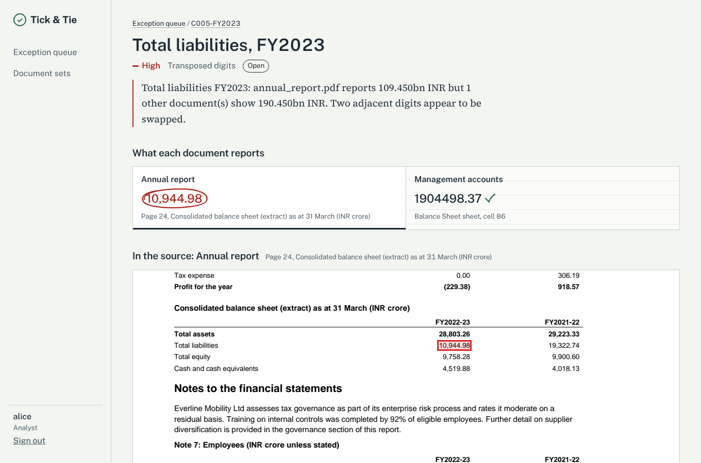

# Tick & Tie: multi-agent financial QA and reconciliation platform

Tick & Tie reconciles the same figures across a company's documents and flags every disagreement with the exact source cell on both sides. The documents are an annual report, board deck, press release, management accounts and KPI files. Reviewers resolve each flag in a web UI, and every decision is kept as an audit trail.

- **Backend:** Python, FastAPI, LangGraph, SQLAlchemy 2 and Alembic.
- **Frontend:** React 18 with TypeScript, built with Vite.
- **Storage:** SQLite by default, Postgres-ready.



More screens are in [docs/screenshots](docs/screenshots): queue, unit error, missing spreadsheet cell, run trace.

## Results on the synthetic test corpus

| Split | Sets | Labels | Precision | Recall | Latency per set |
| --- | --- | --- | --- | --- | --- |
| Dev (FY2023) | 50 | 168 | 1.000 | 1.000 | p50 1.1 s |
| Test (FY2024–25, held out) | 100 | 255 | 1.000 | 1.000 | p50 1.1 s |
| Stress (286 pages + 36k GL rows) | 10 | 73 | 1.000 | 1.000 | 7.6–9.6 s (target ≤ 600 s) |

- **Other measures:** discrepancy-type accuracy was 0.98 and severity accuracy 1.00. All 29 clean sets produced no false positives.
- **Caveat:** these numbers come from synthetic documents produced by the same team that wrote the parsers. They show the pipeline is correct end to end on those formats, but they say nothing yet about real filings. See [Limitations](#limitations).

## Architecture

```
React UI (Vite)  --/api-->  FastAPI  ---------------------------+
                               |                                |
                         RunManager (thread pool)          SQLAlchemy (SQLite / Postgres)
                               |                                |
                    LangGraph StateGraph  <-- checkpoints -->  SqliteSaver / PostgresSaver
                               |
   supervisor -> extraction (1 doc per step) -> reconciliation -> baseline -> exceptions -> finish
                               |
        ToolExecutor: validated JSON-schema tools, retries with backoff, per-call trace rows
```

### Agents (`backend/app/agents/nodes.py`)

| Agent | Responsibility |
| --- | --- |
| Supervisor | Discovers the set and freezes the rules for the run, then routes to the next agent and records the reason. |
| Extraction | Parses one document per step, so a crash loses at most one document of work. |
| Reconciliation | Takes each (metric, period) and computes a rounding-aware consensus across documents. It then classifies each outlier as a sign flip, unit error, stale prior-year value, digit transposition or value mismatch. |
| Baseline | Compares current-year figures with audited history and flags unusual year-on-year moves. It only reads history earlier than the set's fiscal year, a rule enforced inside the tool's query. |
| Exceptions | Upserts structured exception records on a deterministic key and closes ones a re-run no longer finds. |

### Function-calling tools (`backend/app/agents/tools.py`)

The tools are `list_documents`, `extract_line_items`, `load_observations`, `get_historical_baseline`, `persist_exception` and `close_stale_exceptions`.

- **Schemas:** each tool has Pydantic input and output models, and `GET /api/tools` serves the JSON schemas.
- **Execution:** every call goes through `ToolExecutor`. It validates input and output, retries transient errors with exponential backoff, and writes a trace row.

### Custom run loop (`backend/app/agents/runner.py`)

- **Execution:** runs execute in the background with a step limit and cooperative cancellation.
- **Checkpoints:** state is checkpointed after every node.
- **Restarts:** after a crash, a restart resumes unfinished runs automatically. On SIGTERM, in-flight runs pause at the next step boundary and stay resumable, so a deploy never fails them.
- **No duplicates:** tools are idempotent, so a resumed run never creates duplicate rows. Line items are replaced per document and exceptions are upserted by key.

### The LLM's role

Every number is extracted by deterministic parsers, so each value stays traceable to a page and bounding box or to a cell. An LLM is optional, set with `FINQA_LLM_MODEL`. It is only asked which canonical metric an unfamiliar row label means. Answers are cached in `label_mappings`, budgeted per run, and an LLM outage never fails extraction.

## Repository layout

```
backend/
  app/core/        config (env-driven), logging with run_id, auth + roles
  app/db/          ORM models, sessions, Alembic upgrade
  app/domain/      pure logic: vocabulary, periods, units, reconciliation rules (unit-tested)
  app/parsers/     PDF (pypdfium2 page pre-filter + pdfplumber words with bboxes), XLSX, CSV
  app/agents/      LangGraph state, nodes, graph, tools, runner, LLM label mapper
  app/services/    ingestion (upload validation), evidence rendering, rules, corpus seeding
  app/api/         routers: sets, runs, exceptions, evidence, admin
  app/cli.py       migrate / seed / run / eval
  migrations/      Alembic migrations
  tests/           64 tests: domain, parsers, agent runs (crash + resume), API, LLM guard rails
frontend/
  src/pages/       overview, queue (bulk decisions), exception detail (prev/next, shortcuts), sets, set detail, run trace, upload, rules, sign-in
  src/components/  tick-and-tie strip, evidence viewer, decision panel, layout
```

## Quick start (local)

```bash
# backend
cd backend
pip install -e ".[dev]"
python -m app.cli seed --corpus ../../finqa-testdata     # companies, baselines, 160 document sets
uvicorn app.main:app --reload --port 8000              # API docs at http://localhost:8000/docs

# frontend (second terminal)
cd frontend
npm install
npm run dev                                            # http://localhost:5173
```

Sign in as one of the demo users. To fill the queue, open **Document sets** and choose **Review all shown**, or run `make eval-dev`. Press `?` anywhere for keyboard shortcuts.

To run the whole stack in Docker:

```bash
make up    # UI on http://localhost:8080
```

## Measuring accuracy

```bash
make eval-dev      # FY2023 sets: use while developing
make eval-test     # FY2024-25 sets: held out, run rarely
make eval-stress   # 286-page sets: accuracy + latency
```

`eval` runs the real agent graph, the same code path as the API, over a corpus split. It writes `predictions.jsonl`, `timings.csv` and `sets.txt`, then runs the corpus scorer. Ground truth is never loaded into the application.

## API

| Method | Path | Role | Purpose |
| --- | --- | --- | --- |
| GET | `/api/me`, `/api/summary`, `/api/tools` | any | identity, dashboard counts, tool schemas |
| GET / POST | `/api/companies` | any / admin | list / create companies |
| GET / POST | `/api/sets`, `/api/sets/{id}` | any / admin | list, detail, upload (multipart) |
| POST | `/api/sets/{id}/runs` | analyst, admin | start a review (202, background) |
| GET | `/api/runs/{id}`, `/api/runs/{id}/tool-calls` | any | progress, step trace, tool trace |
| POST | `/api/runs/{id}/resume`, `/cancel` | analyst, admin | resume from checkpoint / cancel |
| GET | `/api/exceptions`, `/api/exceptions/{id}` | any | filterable queue, detail with evidence |
| POST | `/api/exceptions/{id}/decisions` | analyst, controller, admin | accept / reject / override / comment / reopen (audited) |
| GET | `/api/exceptions/export.csv` | any | export with the latest decision |
| GET | `/api/documents/{id}/pages/{n}.png?box=` | any | page image with highlighted values |
| GET | `/api/documents/{id}/cells`, `/lines`, `/file` | any | spreadsheet window, CSV lines, download |
| GET / PUT | `/api/settings` | any / admin | anomaly threshold, baseline metrics |

## Security

- **Access control:** there are four roles (analyst, controller, auditor, admin), enforced on the server per endpoint; the UI only mirrors them. Auditors are read-only.
- **Audit trail:** it is append-only. Each entry records the user, role, the status before and after, the comment and a timestamp.
- **Uploads:** extensions are whitelisted and magic bytes must match the extension. Filenames are sanitised, size is limited while streaming, and a failed upload is all-or-nothing.
- **Runtime:** errors never leak stack traces. CORS is restricted, the container runs as a non-root user, and nginx sends security headers and a CSP.
- **No third-party requests:** fonts are bundled. With the LLM disabled, nothing leaves the host, so it can run air-gapped.
- **Demo auth:** the static demo tokens in `FINQA_AUTH_TOKENS` must be replaced. The rest of the code depends only on `get_current_user`, so swapping in OIDC/JWT is one function.

## Verified in development

- **Tests:** all 64 backend tests pass, and ruff is clean. The frontend typechecks and builds.
- **Accuracy:** the agent system was run over all 160 corpus sets; the results are in the table above.
- **Concurrency:** 12 reviews were started at once through the API, and all succeeded.
- **SIGKILL test:** the server was killed with SIGKILL partway through a review (two of five documents done). On restart the run resumed automatically, extracted only the remaining three documents, and finished with no duplicate exceptions.
- **SIGTERM test:** after a graceful stop with SIGTERM, the run stayed resumable and completed on the next start.
- **UI:** the screens were checked in headless Chromium at desktop and mobile widths.

## Limitations

- **Parsers fit the corpus layouts.** The PDF parser expects tables whose title states the unit, a header row of period labels, and right-aligned numbers. Real annual reports vary much more: multi-line labels, notes columns, merged headers and scanned pages. Expect to extend `pdf_parser.py` or add an OCR or table-model path, and to grow the synonym vocabulary. Re-measure on a labelled sample of real filings.
- **Prose is not parsed.** Figures only in narrative text, such as the CEO letter, are not extracted. In the corpus every figure also appears in a table. A natural next step is an LLM extraction pass that must cite the sentence it read.
- **The LLM path is wired but untested against a live model here.** It covers label mapping, its cache and the budget. Tests run in rules-only mode.
- **Docker files were not built here.** The Dockerfiles and compose file were written but not built in this environment. Local runs used uvicorn and Vite directly.
- **Single-process worker pool.** For horizontal scaling, move runs to a queue (Celery, RQ or Arq) on Postgres. The runner's `execute()` is already the unit of work.
