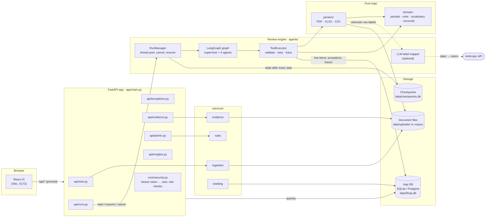
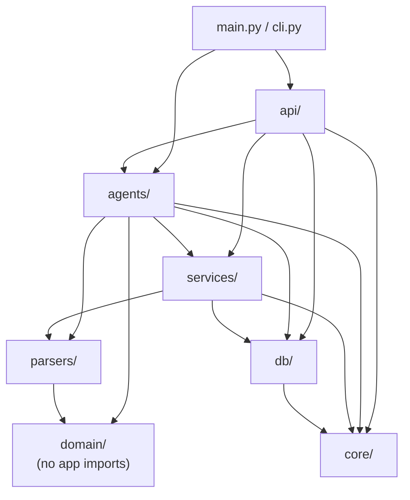
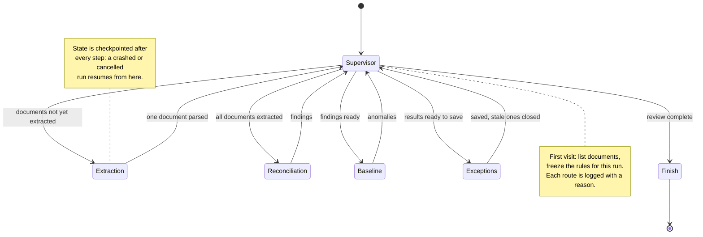
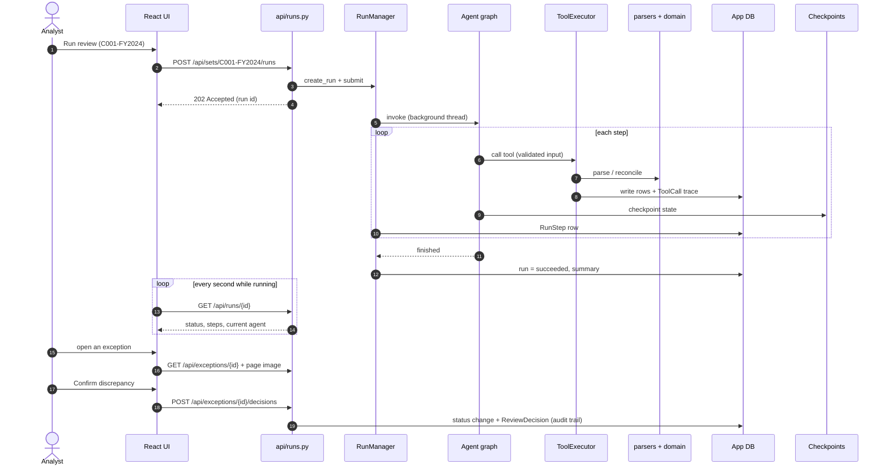
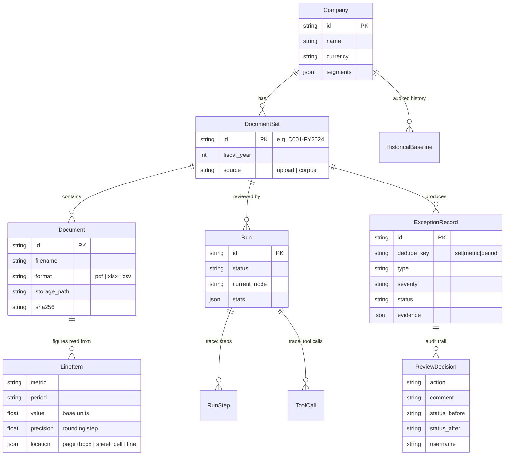

# Backend architecture (`backend/app`)

The backend is about 4,500 lines of Python in seven packages plus three top-level files. The packages are layered: each one depends only on the layers below it.

| Layer | Package | Role |
| --- | --- | --- |
| HTTP | `api/` | FastAPI routers under `/api`: auth-checked endpoints for the React UI |
| Orchestration | `agents/` | The multi-agent review: LangGraph graph, agents, tools, background runner |
| Side jobs | `services/` | Uploads, corpus seeding, evidence rendering, editable rules |
| File reading | `parsers/` | PDF, XLSX and CSV to extracted figures with exact source locations |
| Pure logic | `domain/` | Vocabulary, periods, units and reconciliation rules (no database, no web) |
| Storage | `db/` | SQLAlchemy models, sessions, migrations |
| Plumbing | `core/` | Settings, authentication and roles, logging |

> Diagrams are written in [Mermaid](https://mermaid.js.org). They render on GitHub and in VS Code's Markdown preview with a Mermaid extension (for example *Markdown Preview Mermaid Support*).

---

## 1. System overview

---

## 2. Package dependencies

Arrows point from a package to what it imports. `domain/` imports nothing else in the app, which is what keeps the reconciliation rules simple to unit-test.

---

## 3. The review pipeline (agent graph)

A **supervisor** decides each step and logs a reason; every agent hands control back to it. Extraction runs once **per document**, so a crash loses at most one document's work.

| Agent | What it does | Tools it calls |
| --- | --- | --- |
| Supervisor | Discovers the set, freezes the rules, picks the next agent | `list_documents` |
| Extraction | Parses one document and stores its figures | `extract_line_items` |
| Reconciliation | Compares every metric and period across documents | `load_observations`, `get_historical_baseline` |
| Baseline | Flags unusual year-on-year moves against audited history | `get_historical_baseline` |
| Exceptions | Saves findings idempotently and closes open ones no longer found | `persist_exception`, `close_stale_exceptions` |
| Finish | Builds the run summary | none |

---

## 4. One review, end to end

---

## 5. Data model

`LabelMapping` (cached AI label answers) and `AppSetting` (rules edited by admins) are standalone tables.

---

## 6. Package by package

### `core/`: configuration, security, logging

- **[config.py](../backend/app/core/config.py)**: every setting, from `FINQA_*` environment variables or `backend/.env`. That covers the data folder, database URL, worker threads, the year-on-year threshold, the AI model and call limit, upload limits, allowed browser origins and the demo tokens. `get_settings()` reads them once per process.
- **[security.py](../backend/app/core/security.py)**: four roles (analyst, controller, auditor, admin) and the permission groups `READ_ROLES`, `REVIEW_ROLES`, `RUN_ROLES` and `ADMIN_ROLES`.
  - `get_current_user()` turns the request's bearer token into a user.
  - `require_roles(...)` guards each endpoint and returns 403 for a disallowed role.
  - Login uses fixed demo tokens; moving to SSO/OIDC means rewriting `get_current_user()` only.
- **[logging.py](../backend/app/core/logging.py)**: text or JSON logs. Each line is tagged with the review's run ID, so one review can be followed even when several run at once.

### `db/`: models, sessions, migrations

- **[models.py](../backend/app/db/models.py)**: the tables shown in section 5.
- **[session.py](../backend/app/db/session.py)**: the engine (SQLite in WAL mode by default, Postgres when configured).
  - `session_scope()` commits a block of work if it succeeds and rolls it back if it raises.
  - `get_db()` gives each API request its own session.
- **[migrate.py](../backend/app/db/migrate.py)**: runs the Alembic migrations (in `backend/migrations/`) on every startup.

### `domain/`: the reconciliation rules (pure functions)

- **[types.py](../backend/app/domain/types.py)**: `ExtractedItem` (what a parser reads), `Observation` (an item plus its document) and `Finding` (a candidate discrepancy).
- **[vocabulary.py](../backend/app/domain/vocabulary.py)**: the standard metrics and a synonym table. For example, *Revenue from operations*, *Net sales*, *Total revenue* and `REV` all map to `revenue`. Segment rows map to `segment_revenue:<name>`.
- **[periods.py](../backend/app/domain/periods.py)**: normalises `FY25`, `FY2024-25`, `Q3 FY2025`, `2025Q3` and similar to `FY2025` / `FY2025-Q3`.
- **[units.py](../backend/app/domain/units.py)**: scale words ("million", "crore", "'000", "lakh") as multipliers, and number parsing, where `(12.5)` means negative. It also keeps each number's **display precision**: `8,659.7` million is only known to ±0.05m.
- **[reconcile.py](../backend/app/domain/reconcile.py)**: the core logic.
  - `agree()`: two figures match if they differ by no more than their combined rounding. This prevents false positives from rounding.
  - `reconcile_key()`: takes each document's value for one metric and period and picks the value most documents agree on. Ties are broken by, in order: the audited baseline, not equalling last year's value, finer precision, then document type (management accounts first).
  - `classify()`: labels the outlier, checking in order for a sign error, unit error, stale prior-year value, swapped digits, then a plain value mismatch. A blank in one document is a `missing_item`.
  - `severity()`, `baseline_anomaly()`, and `explain()`, which writes the plain-English sentence shown in the UI.

### `parsers/`: reading documents

Each parser returns `ExtractedItem`s, every one with its exact source location.

- **[\_\_init\_\_.py](../backend/app/parsers/__init__.py)**: `parse_document()` picks a parser by file extension. Each parser receives a `mapper` that turns a row label into a metric (synonyms first, then the AI fallback).
- **[pdf_parser.py](../backend/app/parsers/pdf_parser.py)**: works in three passes.
  1. A fast pypdfium2 filter keeps only pages that state a unit in brackets, like "(USD million)". This is how a 286-page report takes seconds.
  2. Text lines are rebuilt from pdfplumber word boxes.
  3. A state machine walks the lines: a unit in a title starts a table, a line of period labels sets the columns, a line ending in numbers is a data row.

  Every value keeps its bounding box, which the UI uses for the highlight.
- **[xlsx_parser.py](../backend/app/parsers/xlsx_parser.py)**: finds each sheet's unit statement and period header row. Precision comes from the cell's number format, blank cells become "missing" observations, and sheets without a period header (such as a 36,000-row ledger) are skipped quickly.
- **[csv_parser.py](../backend/app/parsers/csv_parser.py)**: long-format KPI files (one row per metric and period). Columns are matched by name, not position.
- **[pdfium_lock.py](../backend/app/parsers/pdfium_lock.py)**: one process-wide lock, because the PDFium C library under pypdfium2 is not thread-safe.

### `agents/`: the multi-agent review

- **[state.py](../backend/app/agents/state.py)**: `ReviewState`, the checkpointed shared memory. It holds small data only; extracted figures live in the database. `RunContext` holds per-run objects that can't be checkpointed, such as the label mapper.
- **[graph.py](../backend/app/agents/graph.py)**: the LangGraph wiring in section 3, with retries for temporary database and network errors.
- **[nodes.py](../backend/app/agents/nodes.py)**: the supervisor and the agents in the table above.
- **[tools.py](../backend/app/agents/tools.py)**: the six tools.
  - Each has Pydantic input and output models; `GET /api/tools` serves their schemas.
  - `ToolExecutor` validates every call, retries temporary errors with growing waits, and writes a `ToolCall` trace row.
  - The tools are **idempotent**: line items are replaced per document, and exceptions are upserted on `dedupe_key` (set, metric, period). That's why a resumed run never creates duplicates.
- **[runner.py](../backend/app/agents/runner.py)**: `RunManager`.
  - Runs reviews on a background thread pool and checkpoints after every step (`data/checkpoints.db`). Each step becomes a `RunStep` row.
  - Enforces the step limit and supports cancelling between steps.
  - On startup it resumes runs a crash left unfinished. On SIGTERM, running reviews stop at the next step and resume later.
- **[llm.py](../backend/app/agents/llm.py)**: the optional AI fallback. The AI never produces numbers; it's only asked which metric an unfamiliar row label means. The resolver tries, in order:
  1. The synonym table.
  2. The `label_mappings` cache.
  3. The model, within a per-run call limit, and only for text shaped like a label (not dates or prose).

### `services/`: work outside the review

- **[ingestion.py](../backend/app/services/ingestion.py)**: safe uploads.
  - Only `.pdf`, `.xlsx` and `.csv` are allowed, and the file's first bytes must match its extension.
  - Filenames are sanitised, the size limit is enforced while streaming, and a failed upload is all-or-nothing.
  - New sets are named `C004-FY2024`, then `-v2`, `-v3`.
- **[seeding.py](../backend/app/services/seeding.py)**: loads the test corpus (companies, baselines, sets), registering files in place. The answer key in `ground_truth/` is never loaded.
- **[evidence.py](../backend/app/services/evidence.py)**: a PDF page rendered as an image with the value boxed, a window of spreadsheet cells, or CSV lines with context.
- **[rules.py](../backend/app/services/rules.py)**: reads and saves the admin-editable rules (anomaly threshold, baseline metrics).

### `api/`: HTTP endpoints (all under `/api`)

| Router | Main endpoints | Who may call |
| --- | --- | --- |
| [sets.py](../backend/app/api/sets.py) | `GET/POST /companies`, `GET /sets`, `GET /sets/{id}`, `POST /sets` (upload) | read: any role · write: admin |
| [runs.py](../backend/app/api/runs.py) | `POST /sets/{id}/runs` (202, or 409 if one is active), `GET /runs`, `GET /runs/{id}`, `/tool-calls`, `/resume`, `/cancel` | read: any role · act: analyst, admin |
| [exceptions.py](../backend/app/api/exceptions.py) | `GET /exceptions` (filterable, most severe first), `GET /exceptions/{id}`, `POST /exceptions/{id}/decisions`, `GET /exceptions/export.csv` | read: any role · decide: analyst, controller, admin |
| [evidence.py](../backend/app/api/evidence.py) | `/documents/{id}/pages/{n}.png?box=`, `/cells`, `/lines`, `/file` | any role |
| [admin.py](../backend/app/api/admin.py) | `/me`, `/summary`, `/tools`, `GET/PUT /settings` | any role · rules: admin |
| [insights.py](../backend/app/api/insights.py) | `/decisions` (audit log), `/reports`, `/users`, `/system` | log and reports: any role · users and system: admin |

Decisions are validated before saving: a false positive needs a comment; a correction needs a value and a comment. Every decision appends a `ReviewDecision` row with the user, role, status before and after, and timestamp.

### Top-level files

- **[main.py](../backend/app/main.py)**: builds the FastAPI app. On startup it configures logging, runs migrations, starts the `RunManager` and resumes unfinished runs. It restricts CORS to the configured origins, never returns stack traces, and mounts the six routers.
- **[schemas.py](../backend/app/schemas.py)**: request and response models, kept separate from the database models so the API stays stable when tables change.
- **[cli.py](../backend/app/cli.py)**: `migrate`, `seed`, `run <set>` and `eval`. `eval` runs the same graph over a corpus split and scores the results against the answer key.

---

## 7. Reliability properties at a glance

| Concern | How it is handled | Where |
| --- | --- | --- |
| Crash mid-review | State checkpointed after every step; unfinished runs resume on startup | `agents/runner.py` |
| Duplicate rows after resume | Idempotent tools: replace per document, upsert per `dedupe_key` | `agents/tools.py` |
| Flaky database or network | Tool-level retries with backoff, plus node-level retry policy | `agents/tools.py`, `agents/graph.py` |
| Runaway graph | Step limit (`FINQA_MAX_STEPS`) | `agents/runner.py` |
| Rounding false positives | Precision-aware equality | `domain/reconcile.py` |
| AI cost or outage | Synonyms and cache first, per-run cap, label-shaped text only; extraction never fails on an AI error | `agents/llm.py` |
| Thread safety of PDFium | One process-wide lock | `parsers/pdfium_lock.py` |
| Unsafe uploads | Extension whitelist, magic bytes, size limit, sanitised names, all-or-nothing | `services/ingestion.py` |
| Unauthorised actions | Role checks on every endpoint; auditors are read-only | `core/security.py` |
| Leaking secrets or internals | No stack traces; no tokens or DB URL in responses | `main.py`, `api/insights.py` |
